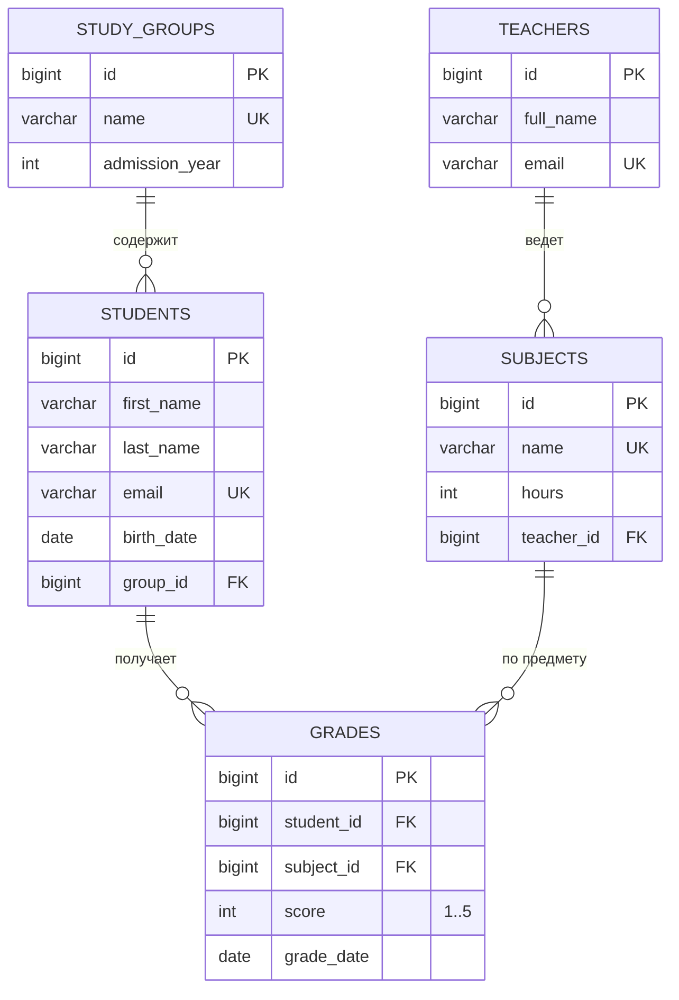
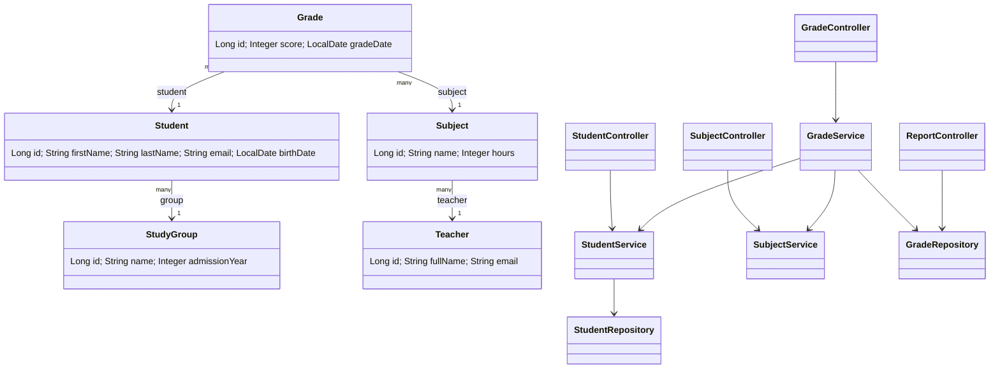

# Учет студентов и оценок (Spring Boot + PostgreSQL)

Курсовой проект: backend REST API на Java 17 / Spring Boot 3 / PostgreSQL.

## Возможности
- 5 связанных таблиц, нормализация до 3NF
- Полный CRUD для всех сущностей (студенты, группы, преподаватели, предметы, оценки)
- Поиск студентов по имени/фамилии
- Отчеты (JOIN + агрегаты: AVG, MIN, MAX, COUNT)
- Валидация ввода (Bean Validation) и единый формат ошибок
- Стартовые данные загружаются автоматически при запуске
- Dockerfile + docker-compose

## Запуск через Docker (рекомендуется, подходит для сервера)
```bash
docker compose up --build -d
```
Приложение: http://localhost:8018/api/students

Остановить: `docker compose down` (с удалением данных БД: `docker compose down -v`).

## Запуск локально без Docker
1. Нужны Java 17, Maven и PostgreSQL.
2. Создать БД: `CREATE DATABASE studentsdb;`
3. Параметры подключения - переменные `DB_URL`, `DB_USER`, `DB_PASSWORD`
   (по умолчанию `jdbc:postgresql://localhost:5432/studentsdb`, `postgres` / `postgres`).
4. `mvn spring-boot:run`

Таблицы и стартовые данные создаются сами (`schema.sql`, `data.sql`).

## Эндпоинты

| Метод | URL | Описание |
|---|---|---|
| GET | `/api/students` | список студентов |
| GET | `/api/students?search=иван` | **поиск** по имени/фамилии |
| GET | `/api/students/{id}` | студент по id |
| GET | `/api/students/{id}/grades` | оценки студента |
| POST / PUT / DELETE | `/api/students[/{id}]` | создать / изменить / удалить |
| GET, POST, PUT, DELETE | `/api/groups` | CRUD групп |
| GET, POST, PUT, DELETE | `/api/teachers` | CRUD преподавателей |
| GET, POST, PUT, DELETE | `/api/subjects` | CRUD предметов |
| GET, POST, PUT, DELETE | `/api/grades` | CRUD оценок (фильтры `?studentId=&subjectId=`) |
| GET | `/api/reports/students-average` | **отчет**: средний балл студентов (рейтинг) |
| GET | `/api/reports/subjects-stats` | **отчет**: средний/мин/макс балл по предметам |
| GET | `/api/reports/groups-stats` | **отчет**: статистика по группам |

### Примеры тела запросов
```json
// POST /api/students
{ "firstName": "Игорь", "lastName": "Орлов", "email": "orlov@student.ru",
  "birthDate": "2005-02-10", "groupId": 1 }

// POST /api/grades
{ "studentId": 1, "subjectId": 2, "score": 5, "gradeDate": "2025-12-20" }

// POST /api/subjects
{ "name": "Физика", "hours": 72, "teacherId": 2 }

// POST /api/groups
{ "name": "ИС-23", "admissionYear": 2024 }

// POST /api/teachers
{ "fullName": "Орлова Ольга Петровна", "email": "orlova@univ.ru" }
```

Пример ошибки валидации (HTTP 400):
```json
{ "status": 400, "error": "Ошибка валидации",
  "details": { "score": "Оценка от 1 до 5", "email": "Некорректный email" } }
```

## ER-диаграмма


## Диаграмма классов

Диаграммы в формате Mermaid отображаются на GitHub/GitLab. Чтобы получить картинку для
отчета: вставить код на https://mermaid.live и нажать Download PNG/SVG.

## Структура проекта
```
src/main/java/com/example/students
 ├── model/        JPA-сущности (таблицы)
 ├── repository/   доступ к БД (Spring Data JPA + JPQL-отчеты)
 ├── service/      бизнес-логика
 ├── controller/   REST-контроллеры
 ├── dto/          запросы (с валидацией) и DTO отчетов
 └── exception/    обработка ошибок
src/main/resources: application.properties, schema.sql, data.sql
```
